# Consultório Privado

**Aplicação web de demonstração para a gestão operacional de um consultório médico**, desenvolvida em **ASP.NET Core MVC (.NET 10)**, com **Entity Framework Core**, **SQL Server** e **Bootstrap**.

O projeto constitui uma prova de conceito de desenvolvimento de sistemas de informação, abrangendo modelação de dados, organização da lógica de negócio, persistência de informação e implementação de interfaces web.

> **Nota:** os dados utilizados nesta demonstração são fictícios. A aplicação não se destina a utilização clínica em produção sem validações e medidas adicionais de segurança, privacidade e conformidade.

## Objetivos

- Estruturar uma aplicação de gestão de consultório em projetos com responsabilidades distintas.
- Implementar operações de gestão de utentes, médicos, especialidades e consultas.
- Aplicar regras de negócio ao agendamento e à disponibilidade dos profissionais.
- Integrar atos clínicos e pagamentos no fluxo operacional.
- Disponibilizar uma visão de conjunto através de um dashboard e de uma agenda semanal.

## Funcionalidades

| Módulo | Funcionalidades principais |
| --- | --- |
| **Utentes** | Registo e gestão da informação dos utentes. |
| **Médicos** | Registo e gestão dos profissionais e respetivas especialidades. |
| **Especialidades** | Organização das especialidades médicas. |
| **Consultas** | Agendamento e gestão de consultas, incluindo duração e validações de disponibilidade. |
| **Horários e indisponibilidades** | Definição de horários semanais e registo de ausências dos médicos. |
| **Atos clínicos** | Gestão dos atos clínicos associados à atividade do consultório. |
| **Pagamentos** | Registo e acompanhamento de pagamentos. |
| **Agenda semanal** | Visualização organizada das consultas por período. |
| **Dashboard** | Consulta de indicadores e informação operacional resumida. |

### Regras de negócio implementadas

O agendamento de consultas contempla validações relacionadas com a **duração da consulta**, a **sobreposição de marcações**, o **horário semanal do médico** e as **indisponibilidades registadas**.

Estas validações procuram assegurar a coerência do agendamento e reduzir conflitos na utilização dos períodos disponíveis.

## Tecnologias utilizadas

- **C# e .NET 10** — desenvolvimento da aplicação.
- **ASP.NET Core MVC** — organização da aplicação web segundo o padrão Model–View–Controller.
- **Entity Framework Core** — acesso e persistência de dados.
- **Microsoft SQL Server** — sistema de gestão de base de dados relacional.
- **Razor Views** — construção das interfaces MVC.
- **Bootstrap** — estrutura e apresentação responsiva das interfaces.
- **Visual Studio 2026** — ambiente de desenvolvimento.
- **Git e GitHub** — controlo de versões e alojamento do código-fonte.

## Arquitetura da solução

A solução está organizada em quatro projetos, de modo a separar responsabilidades:

```text
Consultorio/
├── Consultorio.slnx
├── .gitignore
├── Consultorio.Domain/
├── Consultorio.Application/
├── Consultorio.Infrastructure/
└── Consultorio.Web/
```

| Projeto | Responsabilidade |
| --- | --- |
| `Consultorio.Domain` | Entidades e conceitos centrais do domínio. |
| `Consultorio.Application` | Organização dos casos de uso e da lógica aplicacional. |
| `Consultorio.Infrastructure` | Infraestrutura de persistência e integração com a base de dados. |
| `Consultorio.Web` | Interface web ASP.NET Core MVC, controladores e vistas. |

**Visão conceptual:**

```text
Utilizador
    |
    v
Consultorio.Web
    |
    v
Consultorio.Application
    |
    v
Consultorio.Domain

Consultorio.Infrastructure
    |
    v
SQL Server
```

O diagrama representa a separação conceptual de responsabilidades, não necessariamente todas as dependências técnicas entre projetos.

## Modelo de dados

O modelo de dados da demonstração contempla entidades relacionadas com:

- Utentes e médicos;
- Especialidades;
- Consultas;
- Horários e indisponibilidades dos médicos;
- Atos clínicos;
- Pagamentos.

A persistência é efetuada através do Entity Framework Core, sobre uma base de dados SQL Server.

## Requisitos para execução

- **.NET 10 SDK**;
- **Visual Studio 2026**, ou outro ambiente compatível com .NET 10;
- **SQL Server** acessível no ambiente de execução;
- Acesso aos pacotes NuGet necessários para restaurar as dependências.

## Configuração e execução local

1. Clonar o repositório e abrir `Consultorio.slnx` no Visual Studio.
2. Restaurar os pacotes NuGet, caso o Visual Studio não o faça automaticamente.
3. Configurar a ligação SQL Server em `Consultorio.Web/appsettings.json` ou, preferencialmente, num ficheiro local `Consultorio.Web/appsettings.Development.json` (excluído do Git).
4. Preparar a base de dados `ConsultorioDemo` de acordo com a configuração do Entity Framework Core utilizada no projeto.
5. Definir **`Consultorio.Web`** como projeto de arranque.
6. Compilar a solução e executar a aplicação.

### Exemplo de ligação local

```json
{
  "ConnectionStrings": {
    "Consultorio": "Server=localhost;Database=ConsultorioDemo;Trusted_Connection=True;TrustServerCertificate=True"
  }
}
```

> **Atenção:** a instância SQL Server e o procedimento de criação ou atualização do esquema da base de dados dependem da configuração do ambiente. Antes de executar migrações, confirme a estratégia de inicialização da base de dados adotada no projeto.

## Interfaces da aplicação

As capturas seguintes ilustram as principais funcionalidades da prova de conceito. Todas as imagens estão organizadas na pasta [`docs/screenshots`](docs/screenshots/).

### Visão geral e agenda

**Dashboard operacional**

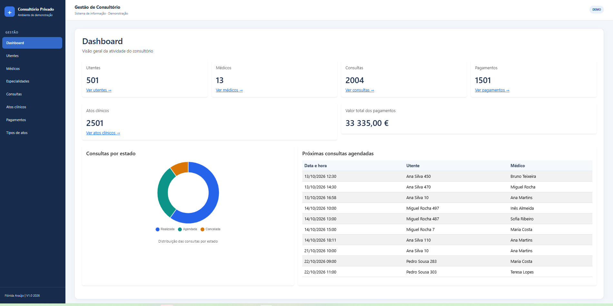

**Agenda semanal**

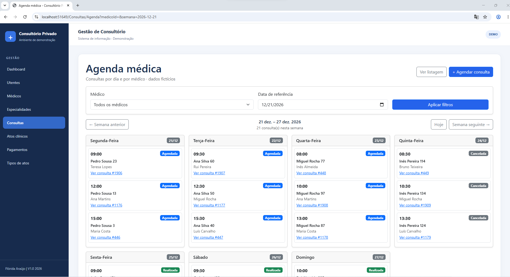

### Gestão de utentes, médicos e consultas

**Utentes**

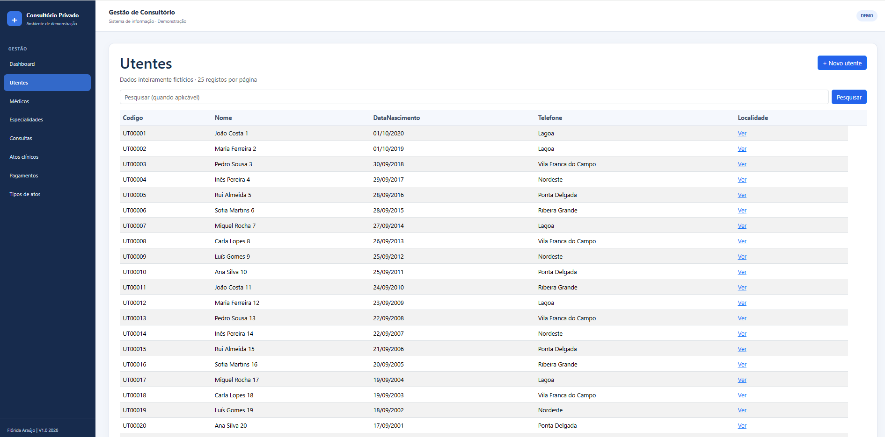

**Médicos — detalhes**

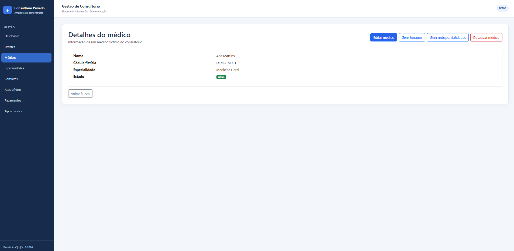

**Consultas**

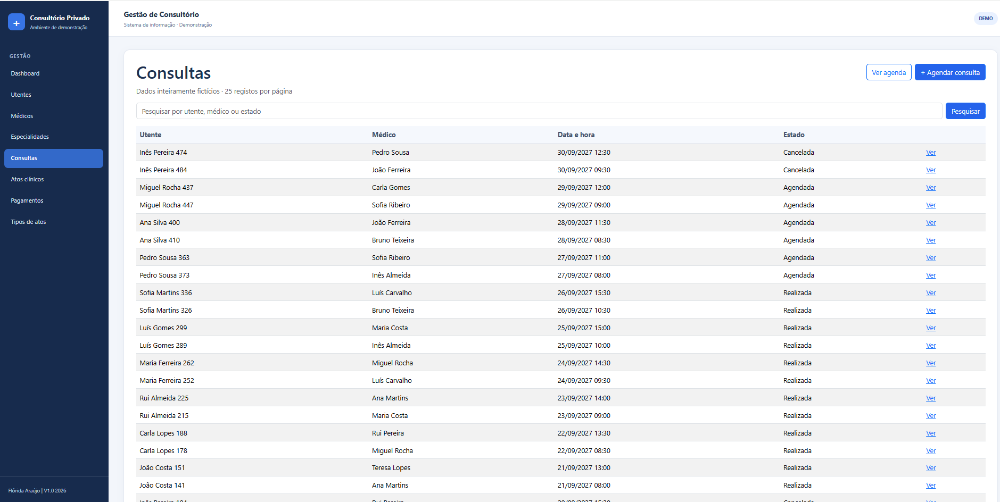

**Detalhes de uma consulta**

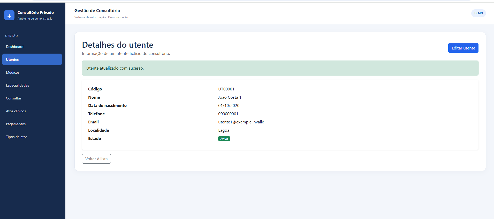

### Atos clínicos e pagamentos

**Atos clínicos**

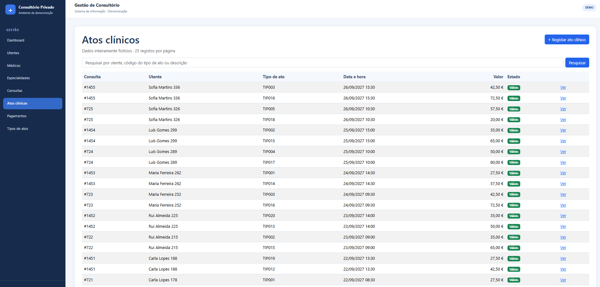

**Tipos de atos clínicos**

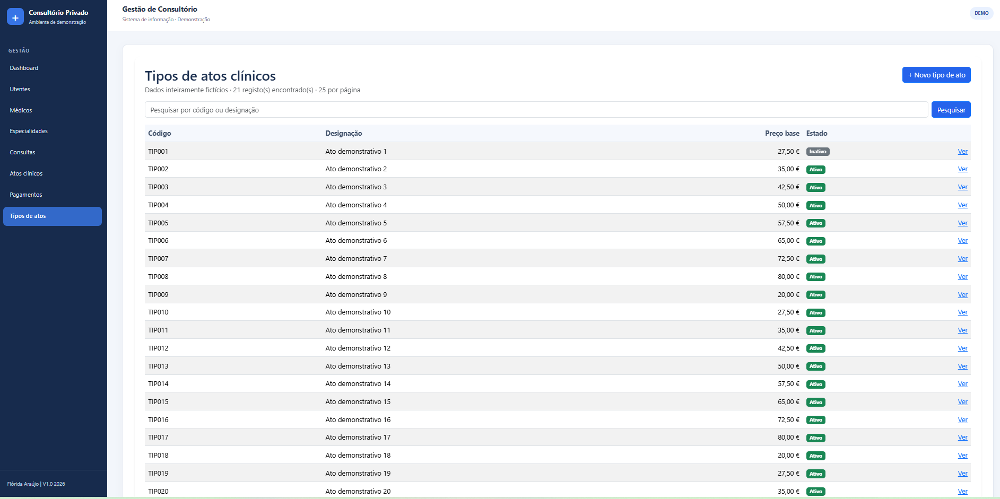

**Pagamentos**

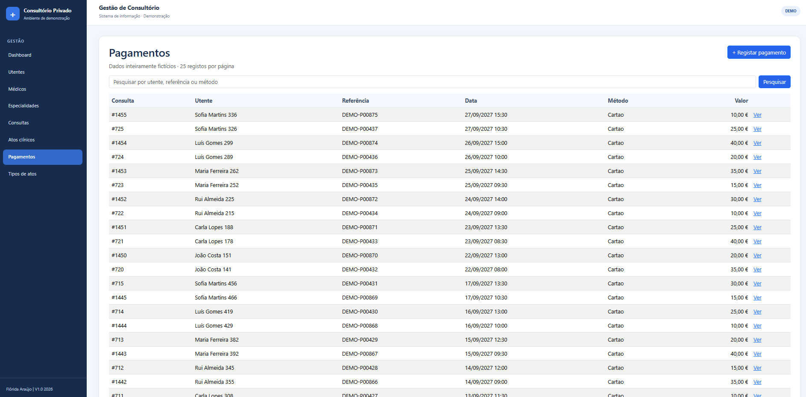

**Detalhes de pagamento**

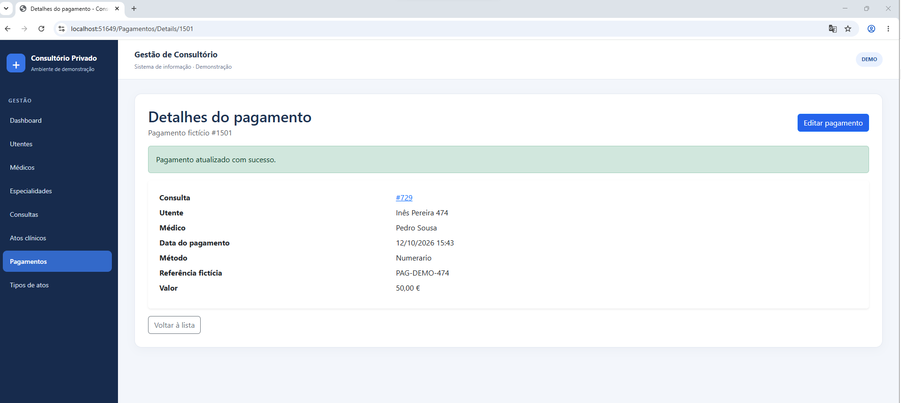

### Disponibilidade médica

**Horários dos médicos**

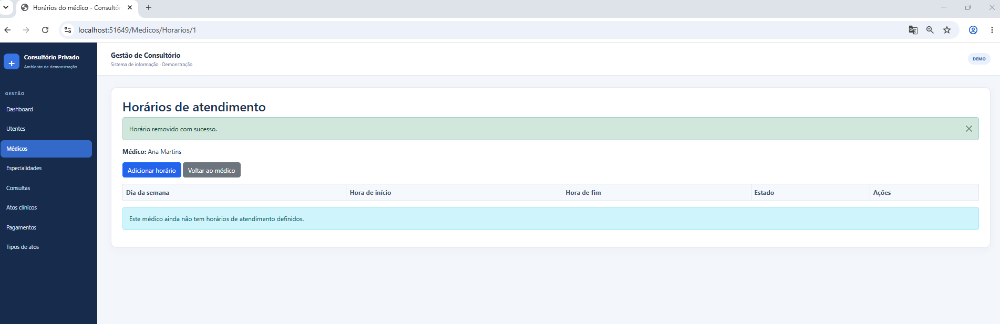

**Indisponibilidades dos médicos**

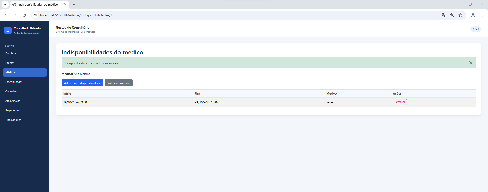

> **Nota:** as imagens destinam-se a ilustrar a aplicação demonstrativa. Confirme que não incluem informação real ou confidencial antes de alterar a visibilidade do repositório.

## Estado do projeto

**Prova de conceito funcional.** Os módulos principais e as validações de agendamento foram implementados. A execução de testes integrados finais e o reforço de requisitos próprios de um ambiente de produção constituem etapas futuras.

### Possíveis evoluções

- Automatização de testes e ampliação da cobertura dos cenários de negócio;
- Autenticação, autorização e perfis de acesso;
- Auditoria de operações e reforço de segurança;
- Melhorias de usabilidade e acessibilidade;
- Relatórios operacionais adicionais;
- Preparação para ambientes de implantação controlados.

## Autoria

**Flórida da Graça Botelho Araújo**  
Sistemas de Informação | Engenharia de Dados | Consultoria Técnico-Funcional

[Perfil LinkedIn](https://www.linkedin.com/in/fgaraujo)

---

*Projeto demonstrativo desenvolvido para fins de aprendizagem, consolidação de competências técnicas e apresentação de portefólio.*
